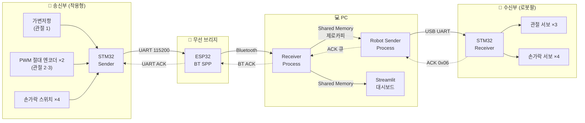

# 🦾 저지연 실시간 동작 모방 로봇팔

> 사용자의 팔·손가락 동작을 센서로 측정하고, 블루투스와 PC를 거쳐 로봇팔이 실시간으로 따라 움직이는 원격 동작 모방 시스템

<br>

## 📌 개요

| 항목 | 내용 |
|------|------|
| **프로젝트명** | 저지연 실시간 동작 모방 로봇팔 (MedArm) |
| **과목** | 사물인터넷프로그래밍 |
| **기간** | 2025 |
| **인원** | 5인 팀 프로젝트 |
| **목표** | 사람의 관절 각도와 손가락 상태를 측정해 로봇팔이 낮은 지연으로 동작을 모방하도록 구현 |

착용형 센서 보드(STM32)가 어깨·팔꿈치 관절 각도 3축과 손가락 스위치 4개의 상태를 읽어 15바이트 패킷으로 만듭니다. 패킷은 ESP32를 통해 블루투스로 PC에 전달되고, PC가 이를 로봇 제어 보드(STM32)로 다시 보내 서보 모터 7개를 구동합니다.

로봇 보드는 패킷을 처리한 뒤 **ACK를 역방향으로 돌려보내고**, 센서 보드가 이를 받아 **전 구간 왕복 지연(RTT)을 직접 측정**합니다. 측정한 지연은 다음 패킷에 실려 웹 대시보드에 실시간으로 표시됩니다.

<br>

## 🎬 동작영상

<!-- 동작 영상 또는 GIF를 아래에 추가하세요 -->
<!-- 예시: [](https://youtu.be/영상ID) -->
<!-- 예시:  -->

> 🔧 동작 영상 추가 예정

<br>

## 🏗️ 시스템 아키텍처



### 데이터 흐름

```
[센서 STM32] ──패킷──→ [ESP32] ──BT──→ [PC] ──USB──→ [Robot STM32]
     ↑                    ↑               │              │
     │                    │            main.py           │
     │                    │               │              │
     │                    │         ACK 큐 전달          │
     │                    │               │              ↓
     │                    └───BT ACK←─────┴────USB ACK───┘
     │
     └──────────────── ACK(0x06) 수신 ───────────────────┘
                            │
                       RTT 측정 완료
```

### 패킷 구조 (15바이트)

```
[0xAA][0x55][A1_H][A1_L][A2_H][A2_L][A3_H][A3_L][F1][F2][F3][F4][RTT_H][RTT_L][Checksum]
   0     1     2     3     4     5     6     7    8   9  10  11   12     13      14
```

| 필드 | 바이트 | 설명 |
|------|--------|------|
| Header | 0-1 | 0xAA, 0x55 |
| Angle 1-3 | 2-7 | signed int16 × 3 (각도 × 10, Big-endian) |
| Finger 1-4 | 8-11 | uint8 × 4 (0: 펼침 / 1: 접힘) |
| RTT | 12-13 | unsigned int16 (ms), 직전 측정값 |
| Checksum | 14 | Byte 2~13 합의 하위 1바이트 |

<br>

## 🛠️ 기술스택

| 분류 | 기술 |
|------|------|
| **Firmware** |   -00979D?style=flat-square&logo=arduino&logoColor=white) |
| **PC / Middleware** |  `pyserial` `multiprocessing` `shared_memory` |
| **Dashboard** |    |
| **Communication** | UART, Bluetooth SPP, USB Virtual COM |
| **Peripheral** | ADC, Timer Input Capture, Timer PWM, GPIO, EXTI |

<br>

## 🔩 사용 하드웨어

| 구분 | 부품 | 용도 |
|------|------|------|
| **MCU** | STM32 Nucleo 보드 ×2 (STM32F4, 84MHz) | 센서 송신부 / 로봇 제어 수신부 |
| **무선 모듈** | ESP32 | UART ↔ Bluetooth SPP 브리지 |
| **센서** | 가변저항 (300°) | 관절 1 각도 측정 (ADC 12bit) |
| | PWM 출력 절대 엔코더 ×2 | 관절 2·3 각도 측정 (Input Capture) |
| | 스위치 ×4 | 손가락 굽힘 상태 감지 |
| **액추에이터** | 서보 모터 ×3 | 로봇팔 관절 구동 (TIM3 CH1~3, 50Hz PWM) |
| | 서보 모터 ×4 | 그리퍼 손가락 구동 (TIM4 CH1~4, 50Hz PWM) |

### 핀 연결

| 연결 | 핀 |
|------|------|
| 센서 STM32 USART1_TX → ESP32 RX2 | PA9 → GPIO16 |
| ESP32 TX2 → 센서 STM32 USART1_RX (ACK) | GPIO17 → PA10 |
| 손가락 스위치 1~4 | PC0 ~ PC3 (Active Low) |
| 영점 설정 버튼 | B1 (EXTI) |

<br>

## ✨ 주요 기능

### 1. 실시간 동작 모방
- 관절 각도 3축 + 손가락 4개 상태를 15바이트 고정 길이 패킷으로 송신
- B1 버튼을 누르면 현재 자세를 영점으로 설정하고 송신 시작
- 손가락 스위치 4개를 동시에 샘플링해 디바운싱

### 2. Full E2E 지연 측정 (RTT)
- 로봇 STM32가 패킷 처리 후 ACK(0x06)를 역방향 경로로 회신
- 센서 STM32가 `HAL_GetTick()`으로 송신~ACK 수신 시간을 측정해 RTT 계산
- 측정된 RTT를 다음 패킷에 실어 PC·대시보드까지 전달

```
1. 센서 STM32: 패킷 전송 직전 HAL_GetTick() 저장
2. 패킷이 ESP32 → BT → PC → USB → Robot STM32로 전달
3. Robot STM32: 패킷 처리 후 ACK(0x06) 전송
4. ACK가 USB → PC → BT → ESP32 → 센서 STM32로 돌아옴
5. 센서 STM32: ACK 수신 시각 - 전송 시각 = RTT
6. 편도 지연 = RTT / 2
```

| 구간 | 예상 지연 |
|------|----------|
| STM32 → ESP32 (UART) | ~1ms |
| ESP32 → PC (BT) | ~10ms |
| PC → Robot STM32 (USB) | ~2ms |
| Robot 처리 + ACK 전송 | ~1ms |
| 역방향 (동일) | ~14ms |
| **총 RTT** | **~28ms** |
| **편도 (E2E)** | **~14ms** |

### 3. 패킷 무결성 검증
- 2바이트 헤더(0xAA 0x55) 기반 상태 머신으로 패킷 동기화
- ESP32와 PC 양쪽에서 체크섬을 검사해 손상된 패킷 폐기

### 4. 멀티프로세스 + 공유 메모리 (제로카피)
- PC에서 수신 프로세스와 로봇 송신 프로세스를 분리해 병렬 처리
- `multiprocessing.shared_memory`로 프로세스 간 데이터를 복사 없이 공유
- 대시보드는 별도 프로세스에서 같은 공유 메모리를 읽기 전용으로 참조

### 5. 실시간 웹 대시보드
- 🤖 로봇팔 3D 시뮬레이션 + 손끝 이동 궤적
- 📊 E2E 지연 / 수신율(Hz) 실시간 그래프
- ⚡ 핵심 지표 (E2E 지연, RTT, 최소/최대/평균 통계)
- ✋ 그리퍼 손가락 상태, 🔗 연결 상태, 📋 시스템 로그

<br>

## 📁 파일 구조

```
Robotic_Arm/
├── STM/
│   ├── STM_Sender_main.c      # 센서 STM32: 각도·스위치 측정, 패킷 송신, ACK 대기 및 RTT 계산
│   └── STM_Receiver_main.c    # 로봇 STM32: 패킷 수신·검증, 서보 7개 PWM 제어, ACK 회신
├── ESP_BT/
│   └── ESP_BT.ino             # ESP32: UART ↔ Bluetooth 양방향 브리지, 체크섬 검증
├── PC/
│   └── main.py                # PC: BT 수신 / 로봇 송신 멀티프로세스, ACK 역전달
├── Dashboard/
│   ├── app.py                 # Streamlit 실시간 대시보드
│   └── shared_data.py         # 공유 메모리 데이터 구조 (44바이트) 정의
└── README.md
```

<br>

## 👥 팀 협업

| 이름 | 역할 | 담당 업무 |
|------|------|----------|
| **이호윤** | 송신부 · 대시보드 | 송신(센서) STM32 펌웨어 구현, 웹 대시보드 코드 통합, 실시간성 개선 (Full E2E RTT 측정 구조) |
| 팀원 2 | | |
| 팀원 3 | | |
| 팀원 4 | | |
| 팀원 5 | | |

- **송신팀 / 수신팀 분리 개발**: 15바이트 패킷 규격을 먼저 확정해 송신부·수신부를 병렬로 개발
- **인터페이스 통합**: 송신 펌웨어 → ESP32 → PC → 수신 펌웨어로 이어지는 패킷·ACK 경로를 통합 테스트

<br>

## 💻 개발 환경

| 구분 | 환경 |
|------|------|
| **OS** | Windows |
| **STM32 IDE** | STM32CubeIDE (HAL, CubeMX 코드 생성) |
| **ESP32 IDE** | Arduino IDE (`BluetoothSerial`) |
| **Python** | Python 3.10+ |
| **Python 패키지** | `pyserial`, `streamlit`, `numpy`, `matplotlib` |

### 실행 방법

**1. 펌웨어 업로드**
```
1) STM_Sender_main.c   → 센서 STM32
2) STM_Receiver_main.c → 로봇 STM32
3) ESP_BT.ino          → ESP32
```

**2. 패키지 설치**
```bash
pip install pyserial streamlit numpy matplotlib
```

**3. PC 프로그램 실행**
```bash
# 터미널 1 - 통신 중계 (BT 수신 포트 / 로봇 송신 포트)
python PC/main.py --port-in COM8 --port-out COM3

# 터미널 2 - 대시보드
cd Dashboard
streamlit run app.py
```

**4. RTT 확인**
- 센서 STM32 시리얼 모니터: `[E2E] RTT=25 ms (avg=24 ms) | A1=45.2 A2=30.1 A3=-10.5`
- 대시보드: ⚡ 핵심 지표 → E2E Latency

### 문제 해결

| 증상 | 확인 사항 |
|------|----------|
| ACK가 오지 않음 | ESP32 GPIO17 ↔ 센서 STM32 PA10 (USART1_RX) 연결 확인 |
| RTT가 100ms 근처로 고정 | ACK 타임아웃 상태 → 위 연결 확인 |
| 대시보드 E2E가 0으로 표시 | `main.py`가 먼저 실행 중인지 확인 (공유 메모리 생성 필요) |
